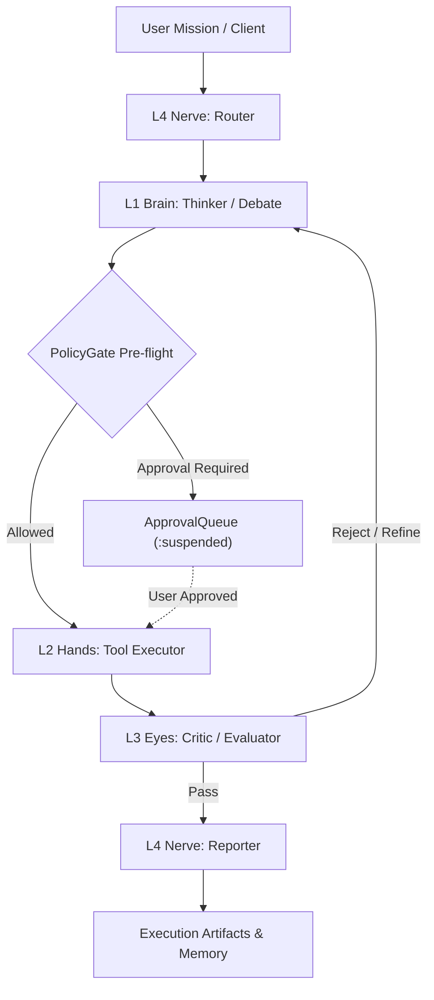
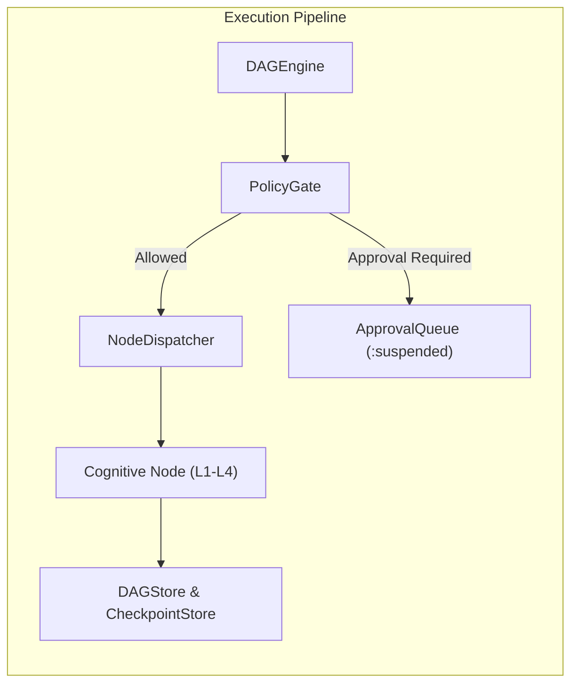

# Architecture Spine — aeagent

## Design Paradigm

The architecture follows an **Event-driven 4-Tier Cognitive Actor System**. Cognitive tasks are framed as outcome-driven graphs executed by a deterministic DAG engine. Cognitive capabilities are split into four strictly delineated layers:

- **L1 Brain (Thinking & Generation)**: Pure reasoning, hypothesis generation, and persona-based collaboration (`lib/aos/agent_os/core/nodes/llm_worker.ex`, `panel_debate.ex`).
- **L2 Hands (Execution & Tools)**: Interacting with external environments, executing tools, and dynamic skill selection (`lib/aos/agent_os/roles/executor.ex`, `skill_selector.ex`, `lib/aos/agent_os/tools/`).
- **L3 Eyes (Reflection & Critique)**: Independent evaluation, output quality assessment, and critical constraint checking (`lib/aos/agent_os/core/nodes/llm_evaluator.ex`, `evolution/quality_evaluator.ex`).
- **L4 Nerve (Routing, Delegation & Reporting)**: Intent-based routing, task delegation, and final report aggregation (`lib/aos/agent_os/roles/intent_router.ex`, `reporter.ex`, `core/nodes/delegator.ex`).

All inter-node transitions are governed as discrete events through `AOS.AgentOS.Orchestration.DAGEngine`, passing an immutable execution context map.



## Invariants & Rules

### AD-1 — Single-Responsibility Cognitive Tiers with Limited Reflection Exception

- **Binds:** `lib/aos/agent_os/core/nodes/`, `lib/aos/agent_os/roles/`
- **Prevents:** Blurring of operational boundaries, bypassing policy gates, and uncontrolled side effects inside LLM generation steps.
- **Rule:** Every node must belong to exactly one cognitive tier (L1 Brain, L2 Hands, L3 Eyes, or L4 Nerve). Composite nodes that combine L1 (Brain) with L2 (Hands: tool execution) or L4 (Nerve: routing/orchestration) are strictly prohibited. Purely internal, read-only self-reflection within L1 prompts is permitted solely for refining candidate text before output emission.

### AD-2 — Granular Node-Level Checkpointing & Namespaced Fan-In Merging

- **Binds:** `lib/aos/agent_os/orchestration/`, `lib/aos/agent_os/tools/`
- **Prevents:** Unnecessary LLM token re-computation, context overwriting during parallel node fan-in, and duplicate external side effects.
- **Rule:** 
  1. Node outputs during fan-in must be namespaced under `context.node_outputs[node_id]`; shared accumulator lists (`:artifacts`, `:execution_history`) must use append-only concatenation rather than destructive key replacement.
  2. Successfully completed nodes commit their output delta to `DAGStore` (and link artifacts to `CheckpointStore`).
  3. Execution resumption (`make local-resume` / `mix agent.resume`) reads committed node states and restarts from the first incomplete/failed node, restoring persisted context.
  4. All L2 Tools executing external mutations must implement idempotency checks or support idempotent execution.

### AD-3 — Human Gatekeeper for High-Impact Strategy Mutations & Evolution

- **Binds:** `lib/aos/agent_os/evolution/`, `lib/aos/agent_os/core/policy_gate.ex`
- **Prevents:** Autonomous self-modifying agents executing high-risk graph mutations, destructive external actions, or budget overruns without human authorization.
- **Rule:** Conservative graph mutations (such as appending an evaluator node upon output failure) may execute autonomously when fitness drops below threshold. However, any graph mutation that introduces destructive external tools, alters safety/domain policies, or exceeds the per-task budget threshold must halt and transition to a `:suspended` state requiring explicit human approval via `PolicyGate` and `ApprovalQueue`.

### AD-4 — Multi-Policy Pre-Flight Gate & Resumable Approval Suspension [ADOPTED]

- **Binds:** `lib/aos/agent_os/core/policy_gate.ex`, `lib/aos/agent_os/orchestration/dag_engine.ex`
- **Prevents:** Execution of unsafe commands, privacy leaks, budget overruns, and permanent dead-ends on human approval requests.
- **Rule:** Every node dispatch in `DAGEngine` must invoke `PolicyGate.check(context, node_id)`. The active policies (`SafetyPolicy`, `BudgetPolicy`, `DomainPolicy`) must all evaluate before dispatch. If a policy returns `{:error, {:approval_required, request}}`, the DAG run must enter `:suspended` state (persisted in `DAGStore` and enqueued in `ApprovalQueue`), which can be resumed once user approval is received. Any non-approval `:error` halts the run with a `PolicyTrace` record.

### AD-5 — Dual Database Strategy for Dev vs CI/Production [ADOPTED]

- **Binds:** `config/`, `lib/aos/repo.ex`, `priv/repo/`
- **Prevents:** Heavy local infrastructure dependencies during development while ensuring transactional integrity and high concurrency in production.
- **Rule:** Local development defaults to SQLite3 (`DATABASE_PATH=priv/repo/aos_dev.db`), while CI and production environments use PostgreSQL. All Ecto migrations in `priv/repo/migrations` must be compatible with both SQLite3 and PostgreSQL adapters.



## Consistency Conventions

| Concern | Convention |
| --- | --- |
| Naming (entities, files, interfaces) | Elixir standard snake_case for file names and modules under `AOS.AgentOS.*`. Node implementations end in `_node.ex` or reside in `core/nodes/`. |
| Data & formats (IDs, envelopes) | UUIDv7 for all primary keys and run execution IDs. Context passing uses atom-keyed Elixir maps with top-level schema keys. Dynamic custom outputs are placed in `node_outputs[node_id]`. |
| Serialization & State | Context serialized to JSON must use string keys in persistence and be restored via standardized deserializer maintaining atom keys for engine control fields. |
| Error handling | Explicit error tuples with standardized atoms (`{:error, {:policy_blocked, reason}}`, `{:suspended, {:approval_required, req}}`). |

## Stack

| Name | Version |
| --- | --- |
| Elixir | 1.18.0 |
| Erlang / OTP | 27.0 |
| Phoenix Framework | 1.8.5 |
| Ecto SQLite3 | 0.22 |
| Postgrex | 0.22 |
| Nx | 0.10 |
| Bumblebee | 0.6 |
| OpenTelemetry | 1.5 |

## Structural Seed

```text
lib/
  aos/
    agent_os/
      core/           # Base domain types, DAG entities, PolicyGate, MemoryStore
      evolution/      # Fitness tracking, strategy mutation & lifecycle
      orchestration/  # DAGEngine, DAGStore, MetaCoordinator, NodeDispatcher
      roles/          # High-level cognitive personas (executor, reporter, etc.)
      skills/         # Dynamic skill definitions, registries, and codecs
      tools/          # Executable tool implementations (L2 Hands)
    runtime/          # Supervision tree, worker processes, runtime configuration
  aos_web/            # Phoenix LiveView dashboards and HTTP endpoints
```

## Operational Envelope

- **Local Development**: Standalone Elixir runtime via `mix` or `make local-server` with SQLite3 (`priv/repo/aos_dev.db`). No Docker requirement for core logic.
- **CI / Testing**: Containerized via `.ci/docker-compose.yml` on GitHub Actions running PostgreSQL and Elixir 1.18.
- **Production / Deployment**: Containerized releases assembled with Burrito (`mix release aeagent`) or deployed via Docker Swarm (`deploy/stack.dev.yml`).

## Deferred

| Decision | Why Deferred |
| --- | --- |
| Multi-node distributed clustering | Single OTP node handles current concurrency; distributed clustering introduces network partition complexity not yet required. |
| Real-time WebSocket streaming of intermediate node tokens | Phoenix LiveView currently polls or subscribes to PubSub execution events; token-by-token streaming can be added once UI requires typewriter-style output. |
| Dynamic third-party WASM sandboxing for tools | Built-in Elixir Ports and strict `PolicyGate` command whitelisting are sufficient for current tool safety boundary. |
